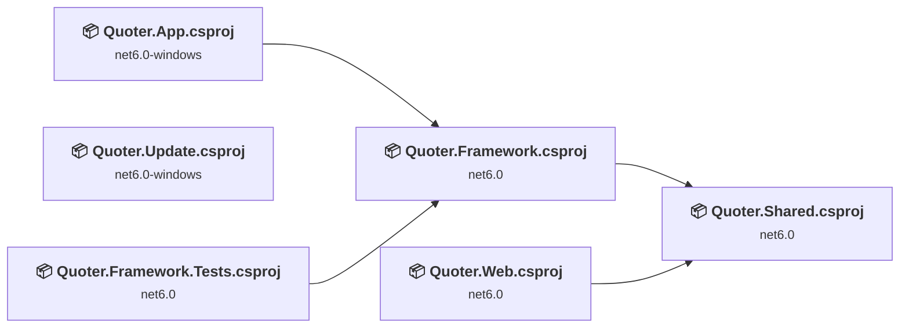
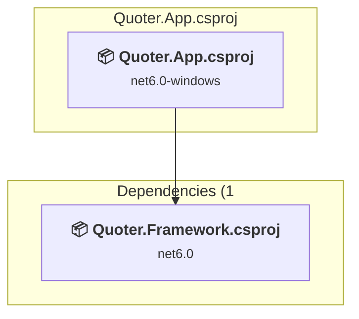
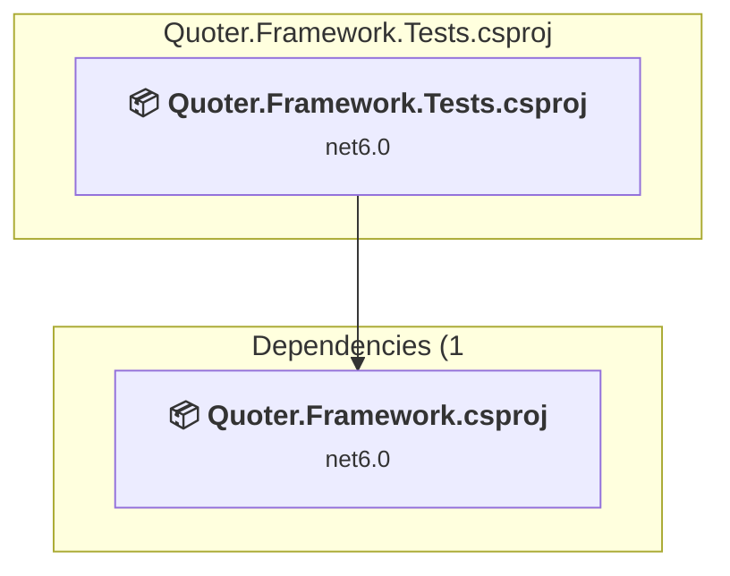
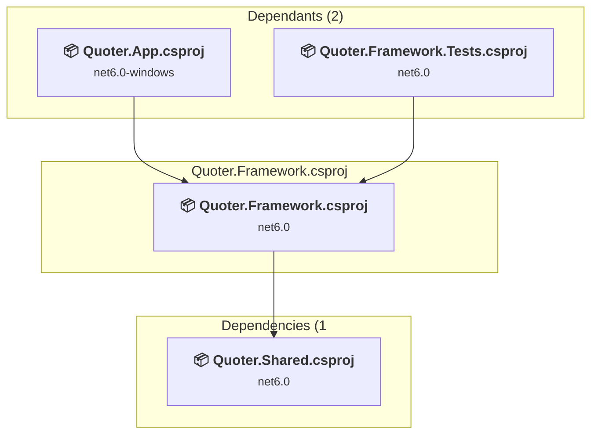
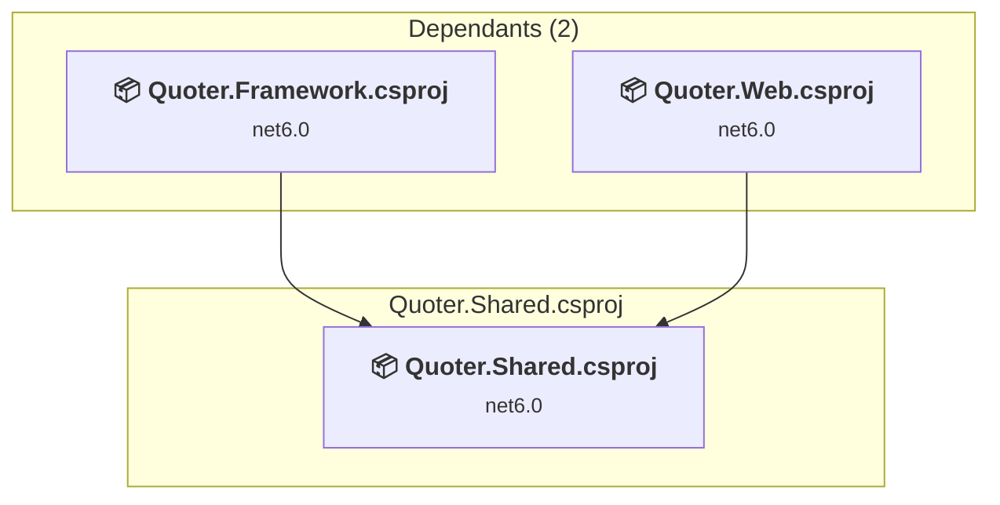
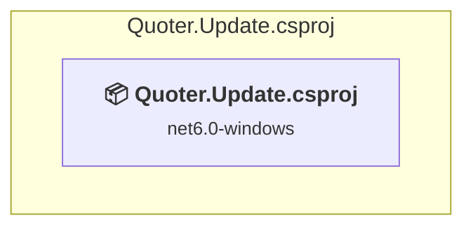
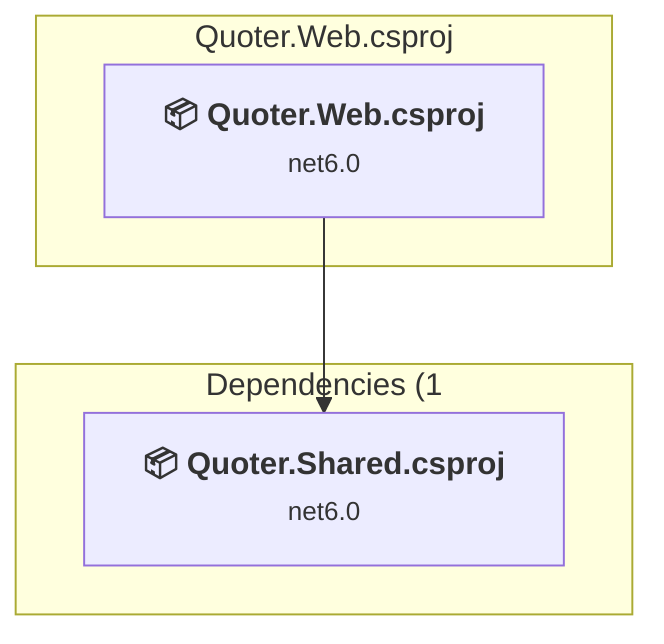

# Projects and dependencies analysis

This document provides a comprehensive overview of the projects and their dependencies in the context of upgrading to .NETCoreApp,Version=v10.0.

## Table of Contents

- [Executive Summary](#executive-Summary)
  - [Highlevel Metrics](#highlevel-metrics)
  - [Projects Compatibility](#projects-compatibility)
  - [Package Compatibility](#package-compatibility)
  - [API Compatibility](#api-compatibility)
  - [Binding Redirect Configuration](#binding-redirect-configuration)
- [Aggregate NuGet packages details](#aggregate-nuget-packages-details)
- [Top API Migration Challenges](#top-api-migration-challenges)
  - [Technologies and Features](#technologies-and-features)
  - [Most Frequent API Issues](#most-frequent-api-issues)
- [Projects Relationship Graph](#projects-relationship-graph)
- [Project Details](#project-details)

  - [Quoter.App\Quoter.App.csproj](#quoterappquoterappcsproj)
  - [Quoter.Framework.Tests\Quoter.Framework.Tests.csproj](#quoterframeworktestsquoterframeworktestscsproj)
  - [Quoter.Framework\Quoter.Framework.csproj](#quoterframeworkquoterframeworkcsproj)
  - [Quoter.Shared\Quoter.Shared.csproj](#quotersharedquotersharedcsproj)
  - [Quoter.Update\Quoter.Update.csproj](#quoterupdatequoterupdatecsproj)
  - [Quoter.Web\Quoter.Web.csproj](#quoterwebquoterwebcsproj)

## Executive Summary

### Highlevel Metrics

| Metric | Count | Status |
| :--- | :---: | :--- |
| Total Projects | 6 | All require upgrade |
| Total NuGet Packages | 289 | 15 need upgrade |
| Total Code Files | 303 |  |
| Total Code Files with Incidents | 71 |  |
| Total Lines of Code | 33579 |  |
| Total Number of Issues | 13050 |  |
| Estimated LOC to modify | 13025+ | at least 38.8% of codebase |

### Projects Compatibility

| Project | Target Framework | Difficulty | Package Issues | API Issues | Binding Issues | Est. LOC Impact | Description |
| :--- | :---: | :---: | :---: | :---: | :---: | :---: | :--- |
| [Quoter.App\Quoter.App.csproj](#quoterappquoterappcsproj) | net6.0-windows | 🟡 Medium | 2 | 12840 | 0 | 12840+ | WinForms, Sdk Style = True |
| [Quoter.Framework.Tests\Quoter.Framework.Tests.csproj](#quoterframeworktestsquoterframeworktestscsproj) | net6.0 | 🟢 Low | 1 | 0 | 0 |  | DotNetCoreApp, Sdk Style = True |
| [Quoter.Framework\Quoter.Framework.csproj](#quoterframeworkquoterframeworkcsproj) | net6.0 | 🟢 Low | 6 | 20 | 0 | 20+ | ClassLibrary, Sdk Style = True |
| [Quoter.Shared\Quoter.Shared.csproj](#quotersharedquotersharedcsproj) | net6.0 | 🟢 Low | 0 | 0 | 0 |  | ClassLibrary, Sdk Style = True |
| [Quoter.Update\Quoter.Update.csproj](#quoterupdatequoterupdatecsproj) | net6.0-windows | 🟡 Medium | 0 | 138 | 0 | 138+ | WinForms, Sdk Style = True |
| [Quoter.Web\Quoter.Web.csproj](#quoterwebquoterwebcsproj) | net6.0 | 🟢 Low | 10 | 27 | 0 | 27+ | AspNetCore, Sdk Style = True |

### Package Compatibility

| Status | Count | Percentage |
| :--- | :---: | :---: |
| ✅ Compatible | 274 | 94.8% |
| ⚠️ Incompatible | 2 | 0.7% |
| 🔄 Upgrade Recommended | 13 | 4.5% |
| ***Total NuGet Packages*** | ***289*** | ***100%*** |

### API Compatibility

| Category | Count | Impact |
| :--- | :---: | :--- |
| 🔴 Binary Incompatible | 11256 | High - Require code changes |
| 🟡 Source Incompatible | 1756 | Medium - Needs re-compilation and potential conflicting API error fixing |
| 🔵 Behavioral change | 13 | Low - Behavioral changes that may require testing at runtime |
| ✅ Compatible | 56824 |  |
| ***Total APIs Analyzed*** | ***69849*** |  |

## Aggregate NuGet packages details

| Package | Current Version | Suggested Version | Projects | Description |
| :--- | :---: | :---: | :--- | :--- |
| AspNetCoreRateLimit | 5.0.0 |  | [Quoter.Web.csproj](#quoterwebquoterwebcsproj) | ✅Compatible |
| Castle.Core | 5.1.1 |  | [Quoter.Framework.Tests.csproj](#quoterframeworktestsquoterframeworktestscsproj) | ✅Compatible |
| coverlet.collector | 3.2.0 |  | [Quoter.Framework.Tests.csproj](#quoterframeworktestsquoterframeworktestscsproj) | ✅Compatible |
| Humanizer | 2.14.1 |  | [Quoter.Web.csproj](#quoterwebquoterwebcsproj) | ✅Compatible |
| Humanizer.Core | 2.14.1 |  | [Quoter.App.csproj](#quoterappquoterappcsproj) [Quoter.Framework.csproj](#quoterframeworkquoterframeworkcsproj) [Quoter.Web.csproj](#quoterwebquoterwebcsproj) | ✅Compatible |
| Humanizer.Core.af | 2.14.1 |  | [Quoter.Web.csproj](#quoterwebquoterwebcsproj) | ✅Compatible |
| Humanizer.Core.ar | 2.14.1 |  | [Quoter.Web.csproj](#quoterwebquoterwebcsproj) | ✅Compatible |
| Humanizer.Core.az | 2.14.1 |  | [Quoter.Web.csproj](#quoterwebquoterwebcsproj) | ✅Compatible |
| Humanizer.Core.bg | 2.14.1 |  | [Quoter.Web.csproj](#quoterwebquoterwebcsproj) | ✅Compatible |
| Humanizer.Core.bn-BD | 2.14.1 |  | [Quoter.Web.csproj](#quoterwebquoterwebcsproj) | ✅Compatible |
| Humanizer.Core.cs | 2.14.1 |  | [Quoter.Web.csproj](#quoterwebquoterwebcsproj) | ✅Compatible |
| Humanizer.Core.da | 2.14.1 |  | [Quoter.Web.csproj](#quoterwebquoterwebcsproj) | ✅Compatible |
| Humanizer.Core.de | 2.14.1 |  | [Quoter.Web.csproj](#quoterwebquoterwebcsproj) | ✅Compatible |
| Humanizer.Core.el | 2.14.1 |  | [Quoter.Web.csproj](#quoterwebquoterwebcsproj) | ✅Compatible |
| Humanizer.Core.es | 2.14.1 |  | [Quoter.Web.csproj](#quoterwebquoterwebcsproj) | ✅Compatible |
| Humanizer.Core.fa | 2.14.1 |  | [Quoter.Web.csproj](#quoterwebquoterwebcsproj) | ✅Compatible |
| Humanizer.Core.fi-FI | 2.14.1 |  | [Quoter.Web.csproj](#quoterwebquoterwebcsproj) | ✅Compatible |
| Humanizer.Core.fr | 2.14.1 |  | [Quoter.Web.csproj](#quoterwebquoterwebcsproj) | ✅Compatible |
| Humanizer.Core.fr-BE | 2.14.1 |  | [Quoter.Web.csproj](#quoterwebquoterwebcsproj) | ✅Compatible |
| Humanizer.Core.he | 2.14.1 |  | [Quoter.Web.csproj](#quoterwebquoterwebcsproj) | ✅Compatible |
| Humanizer.Core.hr | 2.14.1 |  | [Quoter.Web.csproj](#quoterwebquoterwebcsproj) | ✅Compatible |
| Humanizer.Core.hu | 2.14.1 |  | [Quoter.Web.csproj](#quoterwebquoterwebcsproj) | ✅Compatible |
| Humanizer.Core.hy | 2.14.1 |  | [Quoter.Web.csproj](#quoterwebquoterwebcsproj) | ✅Compatible |
| Humanizer.Core.id | 2.14.1 |  | [Quoter.Web.csproj](#quoterwebquoterwebcsproj) | ✅Compatible |
| Humanizer.Core.is | 2.14.1 |  | [Quoter.Web.csproj](#quoterwebquoterwebcsproj) | ✅Compatible |
| Humanizer.Core.it | 2.14.1 |  | [Quoter.Web.csproj](#quoterwebquoterwebcsproj) | ✅Compatible |
| Humanizer.Core.ja | 2.14.1 |  | [Quoter.Web.csproj](#quoterwebquoterwebcsproj) | ✅Compatible |
| Humanizer.Core.ko-KR | 2.14.1 |  | [Quoter.Web.csproj](#quoterwebquoterwebcsproj) | ✅Compatible |
| Humanizer.Core.ku | 2.14.1 |  | [Quoter.Web.csproj](#quoterwebquoterwebcsproj) | ✅Compatible |
| Humanizer.Core.lv | 2.14.1 |  | [Quoter.Web.csproj](#quoterwebquoterwebcsproj) | ✅Compatible |
| Humanizer.Core.ms-MY | 2.14.1 |  | [Quoter.Web.csproj](#quoterwebquoterwebcsproj) | ✅Compatible |
| Humanizer.Core.mt | 2.14.1 |  | [Quoter.Web.csproj](#quoterwebquoterwebcsproj) | ✅Compatible |
| Humanizer.Core.nb | 2.14.1 |  | [Quoter.Web.csproj](#quoterwebquoterwebcsproj) | ✅Compatible |
| Humanizer.Core.nb-NO | 2.14.1 |  | [Quoter.Web.csproj](#quoterwebquoterwebcsproj) | ✅Compatible |
| Humanizer.Core.nl | 2.14.1 |  | [Quoter.Web.csproj](#quoterwebquoterwebcsproj) | ✅Compatible |
| Humanizer.Core.pl | 2.14.1 |  | [Quoter.Web.csproj](#quoterwebquoterwebcsproj) | ✅Compatible |
| Humanizer.Core.pt | 2.14.1 |  | [Quoter.Web.csproj](#quoterwebquoterwebcsproj) | ✅Compatible |
| Humanizer.Core.ro | 2.14.1 |  | [Quoter.Web.csproj](#quoterwebquoterwebcsproj) | ✅Compatible |
| Humanizer.Core.ru | 2.14.1 |  | [Quoter.Web.csproj](#quoterwebquoterwebcsproj) | ✅Compatible |
| Humanizer.Core.sk | 2.14.1 |  | [Quoter.Web.csproj](#quoterwebquoterwebcsproj) | ✅Compatible |
| Humanizer.Core.sl | 2.14.1 |  | [Quoter.Web.csproj](#quoterwebquoterwebcsproj) | ✅Compatible |
| Humanizer.Core.sr | 2.14.1 |  | [Quoter.Web.csproj](#quoterwebquoterwebcsproj) | ✅Compatible |
| Humanizer.Core.sr-Latn | 2.14.1 |  | [Quoter.Web.csproj](#quoterwebquoterwebcsproj) | ✅Compatible |
| Humanizer.Core.sv | 2.14.1 |  | [Quoter.Web.csproj](#quoterwebquoterwebcsproj) | ✅Compatible |
| Humanizer.Core.th-TH | 2.14.1 |  | [Quoter.Web.csproj](#quoterwebquoterwebcsproj) | ✅Compatible |
| Humanizer.Core.tr | 2.14.1 |  | [Quoter.Web.csproj](#quoterwebquoterwebcsproj) | ✅Compatible |
| Humanizer.Core.uk | 2.14.1 |  | [Quoter.Web.csproj](#quoterwebquoterwebcsproj) | ✅Compatible |
| Humanizer.Core.uz-Cyrl-UZ | 2.14.1 |  | [Quoter.Web.csproj](#quoterwebquoterwebcsproj) | ✅Compatible |
| Humanizer.Core.uz-Latn-UZ | 2.14.1 |  | [Quoter.Web.csproj](#quoterwebquoterwebcsproj) | ✅Compatible |
| Humanizer.Core.vi | 2.14.1 |  | [Quoter.Web.csproj](#quoterwebquoterwebcsproj) | ✅Compatible |
| Humanizer.Core.zh-CN | 2.14.1 |  | [Quoter.Web.csproj](#quoterwebquoterwebcsproj) | ✅Compatible |
| Humanizer.Core.zh-Hans | 2.14.1 |  | [Quoter.Web.csproj](#quoterwebquoterwebcsproj) | ✅Compatible |
| Humanizer.Core.zh-Hant | 2.14.1 |  | [Quoter.Web.csproj](#quoterwebquoterwebcsproj) | ✅Compatible |
| LazZiya.TagHelpers | 6.0.2 |  | [Quoter.Web.csproj](#quoterwebquoterwebcsproj) | ✅Compatible |
| MessagePack | 2.1.152 |  | [Quoter.Web.csproj](#quoterwebquoterwebcsproj) | ✅Compatible |
| MessagePack.Annotations | 2.1.152 |  | [Quoter.Web.csproj](#quoterwebquoterwebcsproj) | ✅Compatible |
| MessagePackAnalyzer | 2.1.152 |  | [Quoter.Web.csproj](#quoterwebquoterwebcsproj) | ✅Compatible |
| Microsoft.AspNet.WebApi.Client | 5.2.9 |  | [Quoter.Web.csproj](#quoterwebquoterwebcsproj) | ✅Compatible |
| Microsoft.AspNet.WebApi.Core | 5.2.9 |  | [Quoter.Web.csproj](#quoterwebquoterwebcsproj) | ⚠️NuGet package is incompatible |
| Microsoft.AspNetCore.Cryptography.Internal | 6.0.27 |  | [Quoter.Web.csproj](#quoterwebquoterwebcsproj) | ✅Compatible |
| Microsoft.AspNetCore.Cryptography.KeyDerivation | 6.0.27 |  | [Quoter.Web.csproj](#quoterwebquoterwebcsproj) | ✅Compatible |
| Microsoft.AspNetCore.Diagnostics.EntityFrameworkCore | 6.0.27 | 10.0.15 | [Quoter.Web.csproj](#quoterwebquoterwebcsproj) | NuGet package upgrade is recommended |
| Microsoft.AspNetCore.Http.Abstractions | 2.2.0 |  | [Quoter.Web.csproj](#quoterwebquoterwebcsproj) | ✅Compatible |
| Microsoft.AspNetCore.Http.Extensions | 2.2.0 |  | [Quoter.Web.csproj](#quoterwebquoterwebcsproj) | ✅Compatible |
| Microsoft.AspNetCore.Http.Features | 2.2.0 |  | [Quoter.Web.csproj](#quoterwebquoterwebcsproj) | ✅Compatible |
| Microsoft.AspNetCore.HttpOverrides | 2.2.0 |  | [Quoter.Web.csproj](#quoterwebquoterwebcsproj) | NuGet package functionality is included with framework reference |
| Microsoft.AspNetCore.Identity.EntityFrameworkCore | 6.0.27 | 10.0.15 | [Quoter.Web.csproj](#quoterwebquoterwebcsproj) | NuGet package upgrade is recommended |
| Microsoft.AspNetCore.Identity.UI | 6.0.27 | 10.0.15 | [Quoter.Web.csproj](#quoterwebquoterwebcsproj) | NuGet package upgrade is recommended |
| Microsoft.AspNetCore.Razor.Language | 6.0.0 |  | [Quoter.Web.csproj](#quoterwebquoterwebcsproj) | ✅Compatible |
| Microsoft.Bcl.AsyncInterfaces | 5.0.0 |  | [Quoter.Web.csproj](#quoterwebquoterwebcsproj) | ✅Compatible |
| Microsoft.Build | 17.3.2 |  | [Quoter.Web.csproj](#quoterwebquoterwebcsproj) | ✅Compatible |
| Microsoft.Build.Framework | 17.3.2 |  | [Quoter.Web.csproj](#quoterwebquoterwebcsproj) | ✅Compatible |
| Microsoft.CodeAnalysis.Analyzers | 3.3.2 |  | [Quoter.Web.csproj](#quoterwebquoterwebcsproj) | ✅Compatible |
| Microsoft.CodeAnalysis.AnalyzerUtilities | 3.3.0 |  | [Quoter.Web.csproj](#quoterwebquoterwebcsproj) | ✅Compatible |
| Microsoft.CodeAnalysis.Common | 4.0.0 |  | [Quoter.Web.csproj](#quoterwebquoterwebcsproj) | ✅Compatible |
| Microsoft.CodeAnalysis.CSharp | 4.0.0 |  | [Quoter.Web.csproj](#quoterwebquoterwebcsproj) | ✅Compatible |
| Microsoft.CodeAnalysis.CSharp.Features | 4.0.0 |  | [Quoter.Web.csproj](#quoterwebquoterwebcsproj) | ✅Compatible |
| Microsoft.CodeAnalysis.CSharp.Workspaces | 4.0.0 |  | [Quoter.Web.csproj](#quoterwebquoterwebcsproj) | ✅Compatible |
| Microsoft.CodeAnalysis.Features | 4.0.0 |  | [Quoter.Web.csproj](#quoterwebquoterwebcsproj) | ✅Compatible |
| Microsoft.CodeAnalysis.Razor | 6.0.0 |  | [Quoter.Web.csproj](#quoterwebquoterwebcsproj) | ✅Compatible |
| Microsoft.CodeAnalysis.Scripting.Common | 4.0.0 |  | [Quoter.Web.csproj](#quoterwebquoterwebcsproj) | ✅Compatible |
| Microsoft.CodeAnalysis.Workspaces.Common | 4.0.0 |  | [Quoter.Web.csproj](#quoterwebquoterwebcsproj) | ✅Compatible |
| Microsoft.CodeCoverage | 17.5.0 |  | [Quoter.Framework.Tests.csproj](#quoterframeworktestsquoterframeworktestscsproj) | ✅Compatible |
| Microsoft.CSharp | 4.7.0 |  | [Quoter.Web.csproj](#quoterwebquoterwebcsproj) | ✅Compatible |
| Microsoft.Data.Sqlite.Core | 7.0.16 |  | [Quoter.Web.csproj](#quoterwebquoterwebcsproj) | ✅Compatible |
| Microsoft.Data.Sqlite.Core | 7.0.3 |  | [Quoter.App.csproj](#quoterappquoterappcsproj) [Quoter.Framework.csproj](#quoterframeworkquoterframeworkcsproj) [Quoter.Framework.Tests.csproj](#quoterframeworktestsquoterframeworktestscsproj) | ✅Compatible |
| Microsoft.DiaSymReader | 1.3.0 |  | [Quoter.Web.csproj](#quoterwebquoterwebcsproj) | ✅Compatible |
| Microsoft.DotNet.Scaffolding.Shared | 6.0.16 |  | [Quoter.Web.csproj](#quoterwebquoterwebcsproj) | ✅Compatible |
| Microsoft.EntityFrameworkCore | 7.0.16 |  | [Quoter.Web.csproj](#quoterwebquoterwebcsproj) | ✅Compatible |
| Microsoft.EntityFrameworkCore | 7.0.3 | 10.0.15 | [Quoter.App.csproj](#quoterappquoterappcsproj) [Quoter.Framework.csproj](#quoterframeworkquoterframeworkcsproj) [Quoter.Framework.Tests.csproj](#quoterframeworktestsquoterframeworktestscsproj) | NuGet package upgrade is recommended |
| Microsoft.EntityFrameworkCore.Abstractions | 7.0.16 |  | [Quoter.Web.csproj](#quoterwebquoterwebcsproj) | ✅Compatible |
| Microsoft.EntityFrameworkCore.Abstractions | 7.0.3 |  | [Quoter.App.csproj](#quoterappquoterappcsproj) [Quoter.Framework.csproj](#quoterframeworkquoterframeworkcsproj) [Quoter.Framework.Tests.csproj](#quoterframeworktestsquoterframeworktestscsproj) | ✅Compatible |
| Microsoft.EntityFrameworkCore.Analyzers | 7.0.16 |  | [Quoter.Web.csproj](#quoterwebquoterwebcsproj) | ✅Compatible |
| Microsoft.EntityFrameworkCore.Analyzers | 7.0.3 |  | [Quoter.App.csproj](#quoterappquoterappcsproj) [Quoter.Framework.csproj](#quoterframeworkquoterframeworkcsproj) [Quoter.Framework.Tests.csproj](#quoterframeworktestsquoterframeworktestscsproj) | ✅Compatible |
| Microsoft.EntityFrameworkCore.Design | 7.0.16 | 10.0.15 | [Quoter.Web.csproj](#quoterwebquoterwebcsproj) | NuGet package upgrade is recommended |
| Microsoft.EntityFrameworkCore.Design | 7.0.3 | 10.0.15 | [Quoter.App.csproj](#quoterappquoterappcsproj) [Quoter.Framework.csproj](#quoterframeworkquoterframeworkcsproj) | NuGet package upgrade is recommended |
| Microsoft.EntityFrameworkCore.Relational | 7.0.16 |  | [Quoter.Web.csproj](#quoterwebquoterwebcsproj) | ✅Compatible |
| Microsoft.EntityFrameworkCore.Relational | 7.0.3 |  | [Quoter.App.csproj](#quoterappquoterappcsproj) [Quoter.Framework.csproj](#quoterframeworkquoterframeworkcsproj) [Quoter.Framework.Tests.csproj](#quoterframeworktestsquoterframeworktestscsproj) | ✅Compatible |
| Microsoft.EntityFrameworkCore.Sqlite | 7.0.16 | 10.0.15 | [Quoter.Web.csproj](#quoterwebquoterwebcsproj) | NuGet package upgrade is recommended |
| Microsoft.EntityFrameworkCore.Sqlite | 7.0.3 | 10.0.15 | [Quoter.App.csproj](#quoterappquoterappcsproj) [Quoter.Framework.csproj](#quoterframeworkquoterframeworkcsproj) [Quoter.Framework.Tests.csproj](#quoterframeworktestsquoterframeworktestscsproj) | NuGet package upgrade is recommended |
| Microsoft.EntityFrameworkCore.Sqlite.Core | 7.0.16 |  | [Quoter.Web.csproj](#quoterwebquoterwebcsproj) | ✅Compatible |
| Microsoft.EntityFrameworkCore.Sqlite.Core | 7.0.3 |  | [Quoter.App.csproj](#quoterappquoterappcsproj) [Quoter.Framework.csproj](#quoterframeworkquoterframeworkcsproj) [Quoter.Framework.Tests.csproj](#quoterframeworktestsquoterframeworktestscsproj) | ✅Compatible |
| Microsoft.EntityFrameworkCore.Tools | 7.0.16 | 10.0.15 | [Quoter.Web.csproj](#quoterwebquoterwebcsproj) | NuGet package upgrade is recommended |
| Microsoft.EntityFrameworkCore.Tools | 7.0.3 | 10.0.15 | [Quoter.Framework.csproj](#quoterframeworkquoterframeworkcsproj) | NuGet package upgrade is recommended |
| Microsoft.Extensions.ApiDescription.Server | 6.0.5 |  | [Quoter.Web.csproj](#quoterwebquoterwebcsproj) | ✅Compatible |
| Microsoft.Extensions.Caching.Abstractions | 7.0.0 |  | [Quoter.App.csproj](#quoterappquoterappcsproj) [Quoter.Framework.csproj](#quoterframeworkquoterframeworkcsproj) [Quoter.Framework.Tests.csproj](#quoterframeworktestsquoterframeworktestscsproj) [Quoter.Web.csproj](#quoterwebquoterwebcsproj) | ✅Compatible |
| Microsoft.Extensions.Caching.Memory | 7.0.0 |  | [Quoter.App.csproj](#quoterappquoterappcsproj) [Quoter.Framework.csproj](#quoterframeworkquoterframeworkcsproj) [Quoter.Framework.Tests.csproj](#quoterframeworktestsquoterframeworktestscsproj) [Quoter.Web.csproj](#quoterwebquoterwebcsproj) | ✅Compatible |
| Microsoft.Extensions.Configuration.Abstractions | 7.0.0 |  | [Quoter.App.csproj](#quoterappquoterappcsproj) [Quoter.Framework.csproj](#quoterframeworkquoterframeworkcsproj) [Quoter.Framework.Tests.csproj](#quoterframeworktestsquoterframeworktestscsproj) [Quoter.Web.csproj](#quoterwebquoterwebcsproj) | ✅Compatible |
| Microsoft.Extensions.Configuration.Binder | 7.0.0 |  | [Quoter.Web.csproj](#quoterwebquoterwebcsproj) | ✅Compatible |
| Microsoft.Extensions.DependencyInjection | 7.0.0 |  | [Quoter.App.csproj](#quoterappquoterappcsproj) [Quoter.Framework.csproj](#quoterframeworkquoterframeworkcsproj) [Quoter.Framework.Tests.csproj](#quoterframeworktestsquoterframeworktestscsproj) [Quoter.Web.csproj](#quoterwebquoterwebcsproj) | ✅Compatible |
| Microsoft.Extensions.DependencyInjection.Abstractions | 7.0.0 |  | [Quoter.App.csproj](#quoterappquoterappcsproj) [Quoter.Framework.csproj](#quoterframeworkquoterframeworkcsproj) [Quoter.Framework.Tests.csproj](#quoterframeworktestsquoterframeworktestscsproj) [Quoter.Web.csproj](#quoterwebquoterwebcsproj) | ✅Compatible |
| Microsoft.Extensions.DependencyModel | 7.0.0 |  | [Quoter.App.csproj](#quoterappquoterappcsproj) [Quoter.Framework.csproj](#quoterframeworkquoterframeworkcsproj) [Quoter.Framework.Tests.csproj](#quoterframeworktestsquoterframeworktestscsproj) [Quoter.Web.csproj](#quoterwebquoterwebcsproj) | ✅Compatible |
| Microsoft.Extensions.FileProviders.Abstractions | 7.0.0 |  | [Quoter.Web.csproj](#quoterwebquoterwebcsproj) | ✅Compatible |
| Microsoft.Extensions.FileProviders.Embedded | 6.0.27 |  | [Quoter.Web.csproj](#quoterwebquoterwebcsproj) | ✅Compatible |
| Microsoft.Extensions.Hosting.Abstractions | 7.0.0 |  | [Quoter.Web.csproj](#quoterwebquoterwebcsproj) | ✅Compatible |
| Microsoft.Extensions.Identity.Core | 6.0.27 |  | [Quoter.Web.csproj](#quoterwebquoterwebcsproj) | ✅Compatible |
| Microsoft.Extensions.Identity.Stores | 6.0.27 |  | [Quoter.Web.csproj](#quoterwebquoterwebcsproj) | ✅Compatible |
| Microsoft.Extensions.Logging | 7.0.0 |  | [Quoter.App.csproj](#quoterappquoterappcsproj) [Quoter.Framework.csproj](#quoterframeworkquoterframeworkcsproj) [Quoter.Framework.Tests.csproj](#quoterframeworktestsquoterframeworktestscsproj) [Quoter.Web.csproj](#quoterwebquoterwebcsproj) | ✅Compatible |
| Microsoft.Extensions.Logging.Abstractions | 7.0.0 |  | [Quoter.App.csproj](#quoterappquoterappcsproj) [Quoter.Framework.csproj](#quoterframeworkquoterframeworkcsproj) [Quoter.Framework.Tests.csproj](#quoterframeworktestsquoterframeworktestscsproj) [Quoter.Web.csproj](#quoterwebquoterwebcsproj) | ✅Compatible |
| Microsoft.Extensions.Options | 7.0.0 |  | [Quoter.App.csproj](#quoterappquoterappcsproj) [Quoter.Framework.csproj](#quoterframeworkquoterframeworkcsproj) [Quoter.Framework.Tests.csproj](#quoterframeworktestsquoterframeworktestscsproj) [Quoter.Web.csproj](#quoterwebquoterwebcsproj) | ✅Compatible |
| Microsoft.Extensions.Primitives | 7.0.0 |  | [Quoter.App.csproj](#quoterappquoterappcsproj) [Quoter.Framework.csproj](#quoterframeworkquoterframeworkcsproj) [Quoter.Framework.Tests.csproj](#quoterframeworktestsquoterframeworktestscsproj) [Quoter.Web.csproj](#quoterwebquoterwebcsproj) | ✅Compatible |
| Microsoft.Net.Http.Headers | 2.2.0 |  | [Quoter.Web.csproj](#quoterwebquoterwebcsproj) | ✅Compatible |
| Microsoft.NET.StringTools | 17.3.2 |  | [Quoter.Web.csproj](#quoterwebquoterwebcsproj) | ✅Compatible |
| Microsoft.NET.Test.Sdk | 17.5.0 |  | [Quoter.Framework.Tests.csproj](#quoterframeworktestsquoterframeworktestscsproj) | ✅Compatible |
| Microsoft.NETCore.Platforms | 1.1.0 |  | [Quoter.App.csproj](#quoterappquoterappcsproj) [Quoter.Framework.Tests.csproj](#quoterframeworktestsquoterframeworktestscsproj) [Quoter.Web.csproj](#quoterwebquoterwebcsproj) | ✅Compatible |
| Microsoft.NETCore.Targets | 1.1.0 |  | [Quoter.App.csproj](#quoterappquoterappcsproj) [Quoter.Framework.Tests.csproj](#quoterframeworktestsquoterframeworktestscsproj) [Quoter.Web.csproj](#quoterwebquoterwebcsproj) | ✅Compatible |
| Microsoft.OpenApi | 1.2.3 |  | [Quoter.Web.csproj](#quoterwebquoterwebcsproj) | ✅Compatible |
| Microsoft.TestPlatform.ObjectModel | 17.5.0 |  | [Quoter.Framework.Tests.csproj](#quoterframeworktestsquoterframeworktestscsproj) | ✅Compatible |
| Microsoft.TestPlatform.TestHost | 17.5.0 |  | [Quoter.Framework.Tests.csproj](#quoterframeworktestsquoterframeworktestscsproj) | ✅Compatible |
| Microsoft.VisualStudio.Debugger.Contracts | 17.2.0 |  | [Quoter.Web.csproj](#quoterwebquoterwebcsproj) | ✅Compatible |
| Microsoft.VisualStudio.Web.CodeGeneration | 6.0.16 |  | [Quoter.Web.csproj](#quoterwebquoterwebcsproj) | ✅Compatible |
| Microsoft.VisualStudio.Web.CodeGeneration.Core | 6.0.16 |  | [Quoter.Web.csproj](#quoterwebquoterwebcsproj) | ✅Compatible |
| Microsoft.VisualStudio.Web.CodeGeneration.Design | 6.0.16 | 10.0.3 | [Quoter.Web.csproj](#quoterwebquoterwebcsproj) | NuGet package upgrade is recommended |
| Microsoft.VisualStudio.Web.CodeGeneration.EntityFrameworkCore | 6.0.16 |  | [Quoter.Web.csproj](#quoterwebquoterwebcsproj) | ✅Compatible |
| Microsoft.VisualStudio.Web.CodeGeneration.Templating | 6.0.16 |  | [Quoter.Web.csproj](#quoterwebquoterwebcsproj) | ✅Compatible |
| Microsoft.VisualStudio.Web.CodeGeneration.Utils | 6.0.16 |  | [Quoter.Web.csproj](#quoterwebquoterwebcsproj) | ✅Compatible |
| Microsoft.VisualStudio.Web.CodeGenerators.Mvc | 6.0.16 |  | [Quoter.Web.csproj](#quoterwebquoterwebcsproj) | ✅Compatible |
| Microsoft.Win32.Primitives | 4.3.0 |  | [Quoter.Framework.Tests.csproj](#quoterframeworktestsquoterframeworktestscsproj) [Quoter.Web.csproj](#quoterwebquoterwebcsproj) | ✅Compatible |
| Microsoft.Win32.SystemEvents | 6.0.0 |  | [Quoter.Web.csproj](#quoterwebquoterwebcsproj) | ✅Compatible |
| Microsoft.Win32.SystemEvents | 7.0.0 |  | [Quoter.App.csproj](#quoterappquoterappcsproj) [Quoter.Framework.csproj](#quoterframeworkquoterframeworkcsproj) [Quoter.Framework.Tests.csproj](#quoterframeworktestsquoterframeworktestscsproj) | ✅Compatible |
| Mono.TextTemplating | 2.2.1 |  | [Quoter.App.csproj](#quoterappquoterappcsproj) [Quoter.Framework.csproj](#quoterframeworkquoterframeworkcsproj) [Quoter.Web.csproj](#quoterwebquoterwebcsproj) | ✅Compatible |
| Moq | 4.18.4 |  | [Quoter.Framework.Tests.csproj](#quoterframeworktestsquoterframeworktestscsproj) | ✅Compatible |
| NETStandard.Library | 1.6.1 |  | [Quoter.Framework.Tests.csproj](#quoterframeworktestsquoterframeworktestscsproj) [Quoter.Web.csproj](#quoterwebquoterwebcsproj) | ✅Compatible |
| Newtonsoft.Json | 13.0.1 | 13.0.4 | [Quoter.App.csproj](#quoterappquoterappcsproj) [Quoter.Framework.csproj](#quoterframeworkquoterframeworkcsproj) [Quoter.Framework.Tests.csproj](#quoterframeworktestsquoterframeworktestscsproj) | NuGet package upgrade is recommended |
| Newtonsoft.Json | 13.0.2 |  | [Quoter.Web.csproj](#quoterwebquoterwebcsproj) | ✅Compatible |
| Newtonsoft.Json.Bson | 1.0.1 |  | [Quoter.Web.csproj](#quoterwebquoterwebcsproj) | ✅Compatible |
| NuGet.Common | 6.6.1 |  | [Quoter.Web.csproj](#quoterwebquoterwebcsproj) | ✅Compatible |
| NuGet.Configuration | 6.6.1 |  | [Quoter.Web.csproj](#quoterwebquoterwebcsproj) | ✅Compatible |
| NuGet.DependencyResolver.Core | 6.6.1 |  | [Quoter.Web.csproj](#quoterwebquoterwebcsproj) | ✅Compatible |
| NuGet.Frameworks | 5.11.0 |  | [Quoter.Framework.Tests.csproj](#quoterframeworktestsquoterframeworktestscsproj) | ✅Compatible |
| NuGet.Frameworks | 6.6.1 |  | [Quoter.Web.csproj](#quoterwebquoterwebcsproj) | ✅Compatible |
| NuGet.LibraryModel | 6.6.1 |  | [Quoter.Web.csproj](#quoterwebquoterwebcsproj) | ✅Compatible |
| NuGet.Packaging | 6.6.1 |  | [Quoter.Web.csproj](#quoterwebquoterwebcsproj) | ✅Compatible |
| NuGet.ProjectModel | 6.6.1 |  | [Quoter.Web.csproj](#quoterwebquoterwebcsproj) | ✅Compatible |
| NuGet.Protocol | 6.6.1 |  | [Quoter.Web.csproj](#quoterwebquoterwebcsproj) | ✅Compatible |
| NuGet.Versioning | 6.6.1 |  | [Quoter.Web.csproj](#quoterwebquoterwebcsproj) | ✅Compatible |
| runtime.debian.8-x64.runtime.native.System.Security.Cryptography.OpenSsl | 4.3.0 |  | [Quoter.Framework.Tests.csproj](#quoterframeworktestsquoterframeworktestscsproj) [Quoter.Web.csproj](#quoterwebquoterwebcsproj) | ✅Compatible |
| runtime.fedora.23-x64.runtime.native.System.Security.Cryptography.OpenSsl | 4.3.0 |  | [Quoter.Framework.Tests.csproj](#quoterframeworktestsquoterframeworktestscsproj) [Quoter.Web.csproj](#quoterwebquoterwebcsproj) | ✅Compatible |
| runtime.fedora.24-x64.runtime.native.System.Security.Cryptography.OpenSsl | 4.3.0 |  | [Quoter.Framework.Tests.csproj](#quoterframeworktestsquoterframeworktestscsproj) [Quoter.Web.csproj](#quoterwebquoterwebcsproj) | ✅Compatible |
| runtime.native.System | 4.3.0 |  | [Quoter.Framework.Tests.csproj](#quoterframeworktestsquoterframeworktestscsproj) [Quoter.Web.csproj](#quoterwebquoterwebcsproj) | ✅Compatible |
| runtime.native.System.IO.Compression | 4.3.0 |  | [Quoter.Framework.Tests.csproj](#quoterframeworktestsquoterframeworktestscsproj) [Quoter.Web.csproj](#quoterwebquoterwebcsproj) | ✅Compatible |
| runtime.native.System.Net.Http | 4.3.0 |  | [Quoter.Framework.Tests.csproj](#quoterframeworktestsquoterframeworktestscsproj) [Quoter.Web.csproj](#quoterwebquoterwebcsproj) | ✅Compatible |
| runtime.native.System.Security.Cryptography.Apple | 4.3.0 |  | [Quoter.Framework.Tests.csproj](#quoterframeworktestsquoterframeworktestscsproj) [Quoter.Web.csproj](#quoterwebquoterwebcsproj) | ✅Compatible |
| runtime.native.System.Security.Cryptography.OpenSsl | 4.3.0 |  | [Quoter.Framework.Tests.csproj](#quoterframeworktestsquoterframeworktestscsproj) [Quoter.Web.csproj](#quoterwebquoterwebcsproj) | ✅Compatible |
| runtime.opensuse.13.2-x64.runtime.native.System.Security.Cryptography.OpenSsl | 4.3.0 |  | [Quoter.Framework.Tests.csproj](#quoterframeworktestsquoterframeworktestscsproj) [Quoter.Web.csproj](#quoterwebquoterwebcsproj) | ✅Compatible |
| runtime.opensuse.42.1-x64.runtime.native.System.Security.Cryptography.OpenSsl | 4.3.0 |  | [Quoter.Framework.Tests.csproj](#quoterframeworktestsquoterframeworktestscsproj) [Quoter.Web.csproj](#quoterwebquoterwebcsproj) | ✅Compatible |
| runtime.osx.10.10-x64.runtime.native.System.Security.Cryptography.Apple | 4.3.0 |  | [Quoter.Framework.Tests.csproj](#quoterframeworktestsquoterframeworktestscsproj) [Quoter.Web.csproj](#quoterwebquoterwebcsproj) | ✅Compatible |
| runtime.osx.10.10-x64.runtime.native.System.Security.Cryptography.OpenSsl | 4.3.0 |  | [Quoter.Framework.Tests.csproj](#quoterframeworktestsquoterframeworktestscsproj) [Quoter.Web.csproj](#quoterwebquoterwebcsproj) | ✅Compatible |
| runtime.rhel.7-x64.runtime.native.System.Security.Cryptography.OpenSsl | 4.3.0 |  | [Quoter.Framework.Tests.csproj](#quoterframeworktestsquoterframeworktestscsproj) [Quoter.Web.csproj](#quoterwebquoterwebcsproj) | ✅Compatible |
| runtime.ubuntu.14.04-x64.runtime.native.System.Security.Cryptography.OpenSsl | 4.3.0 |  | [Quoter.Framework.Tests.csproj](#quoterframeworktestsquoterframeworktestscsproj) [Quoter.Web.csproj](#quoterwebquoterwebcsproj) | ✅Compatible |
| runtime.ubuntu.16.04-x64.runtime.native.System.Security.Cryptography.OpenSsl | 4.3.0 |  | [Quoter.Framework.Tests.csproj](#quoterframeworktestsquoterframeworktestscsproj) [Quoter.Web.csproj](#quoterwebquoterwebcsproj) | ✅Compatible |
| runtime.ubuntu.16.10-x64.runtime.native.System.Security.Cryptography.OpenSsl | 4.3.0 |  | [Quoter.Framework.Tests.csproj](#quoterframeworktestsquoterframeworktestscsproj) [Quoter.Web.csproj](#quoterwebquoterwebcsproj) | ✅Compatible |
| Serilog | 4.0.0 |  | [Quoter.Web.csproj](#quoterwebquoterwebcsproj) | ✅Compatible |
| Serilog.AspNetCore | 7.0.0 |  | [Quoter.Web.csproj](#quoterwebquoterwebcsproj) | ✅Compatible |
| Serilog.Extensions.Hosting | 7.0.0 |  | [Quoter.Web.csproj](#quoterwebquoterwebcsproj) | ✅Compatible |
| Serilog.Extensions.Logging | 7.0.0 |  | [Quoter.Web.csproj](#quoterwebquoterwebcsproj) | ✅Compatible |
| Serilog.Formatting.Compact | 1.1.0 |  | [Quoter.Web.csproj](#quoterwebquoterwebcsproj) | ✅Compatible |
| Serilog.Settings.Configuration | 7.0.0 |  | [Quoter.Web.csproj](#quoterwebquoterwebcsproj) | ✅Compatible |
| Serilog.Sinks.Console | 6.0.0 |  | [Quoter.Web.csproj](#quoterwebquoterwebcsproj) | ✅Compatible |
| Serilog.Sinks.Debug | 2.0.0 |  | [Quoter.Web.csproj](#quoterwebquoterwebcsproj) | ✅Compatible |
| Serilog.Sinks.File | 5.0.0 |  | [Quoter.Web.csproj](#quoterwebquoterwebcsproj) | ✅Compatible |
| Serilog.Sinks.SQLite | 5.5.0 |  | [Quoter.Web.csproj](#quoterwebquoterwebcsproj) | ✅Compatible |
| SQLitePCLRaw.bundle_e_sqlite3 | 2.1.4 |  | [Quoter.App.csproj](#quoterappquoterappcsproj) [Quoter.Framework.csproj](#quoterframeworkquoterframeworkcsproj) [Quoter.Framework.Tests.csproj](#quoterframeworktestsquoterframeworktestscsproj) [Quoter.Web.csproj](#quoterwebquoterwebcsproj) | ✅Compatible |
| SQLitePCLRaw.core | 2.1.4 |  | [Quoter.App.csproj](#quoterappquoterappcsproj) [Quoter.Framework.csproj](#quoterframeworkquoterframeworkcsproj) [Quoter.Framework.Tests.csproj](#quoterframeworktestsquoterframeworktestscsproj) [Quoter.Web.csproj](#quoterwebquoterwebcsproj) | ✅Compatible |
| SQLitePCLRaw.lib.e_sqlite3 | 2.1.4 |  | [Quoter.App.csproj](#quoterappquoterappcsproj) [Quoter.Framework.csproj](#quoterframeworkquoterframeworkcsproj) [Quoter.Framework.Tests.csproj](#quoterframeworktestsquoterframeworktestscsproj) [Quoter.Web.csproj](#quoterwebquoterwebcsproj) | ✅Compatible |
| SQLitePCLRaw.provider.e_sqlite3 | 2.1.4 |  | [Quoter.App.csproj](#quoterappquoterappcsproj) [Quoter.Framework.csproj](#quoterframeworkquoterframeworkcsproj) [Quoter.Framework.Tests.csproj](#quoterframeworktestsquoterframeworktestscsproj) [Quoter.Web.csproj](#quoterwebquoterwebcsproj) | ✅Compatible |
| Stub.System.Data.SQLite.Core.NetStandard | 1.0.116 |  | [Quoter.Web.csproj](#quoterwebquoterwebcsproj) | ✅Compatible |
| Swashbuckle.AspNetCore | 6.5.0 |  | [Quoter.Web.csproj](#quoterwebquoterwebcsproj) | ✅Compatible |
| Swashbuckle.AspNetCore.Swagger | 6.5.0 |  | [Quoter.Web.csproj](#quoterwebquoterwebcsproj) | ✅Compatible |
| Swashbuckle.AspNetCore.SwaggerGen | 6.5.0 |  | [Quoter.Web.csproj](#quoterwebquoterwebcsproj) | ✅Compatible |
| Swashbuckle.AspNetCore.SwaggerUI | 6.5.0 |  | [Quoter.Web.csproj](#quoterwebquoterwebcsproj) | ✅Compatible |
| System.AppContext | 4.3.0 |  | [Quoter.Framework.Tests.csproj](#quoterframeworktestsquoterframeworktestscsproj) [Quoter.Web.csproj](#quoterwebquoterwebcsproj) | ✅Compatible |
| System.Buffers | 4.3.0 |  | [Quoter.Framework.Tests.csproj](#quoterframeworktestsquoterframeworktestscsproj) | ✅Compatible |
| System.Buffers | 4.5.0 |  | [Quoter.Web.csproj](#quoterwebquoterwebcsproj) | ✅Compatible |
| System.CodeDom | 4.4.0 |  | [Quoter.App.csproj](#quoterappquoterappcsproj) [Quoter.Framework.csproj](#quoterframeworkquoterframeworkcsproj) [Quoter.Web.csproj](#quoterwebquoterwebcsproj) | ✅Compatible |
| System.Collections | 4.3.0 |  | [Quoter.Framework.Tests.csproj](#quoterframeworktestsquoterframeworktestscsproj) [Quoter.Web.csproj](#quoterwebquoterwebcsproj) | ✅Compatible |
| System.Collections.Concurrent | 4.3.0 |  | [Quoter.Framework.Tests.csproj](#quoterframeworktestsquoterframeworktestscsproj) [Quoter.Web.csproj](#quoterwebquoterwebcsproj) | ✅Compatible |
| System.Collections.Immutable | 6.0.0 |  | [Quoter.Web.csproj](#quoterwebquoterwebcsproj) | ✅Compatible |
| System.Composition | 1.0.31 |  | [Quoter.Web.csproj](#quoterwebquoterwebcsproj) | ✅Compatible |
| System.Composition.AttributedModel | 1.0.31 |  | [Quoter.Web.csproj](#quoterwebquoterwebcsproj) | ✅Compatible |
| System.Composition.Convention | 1.0.31 |  | [Quoter.Web.csproj](#quoterwebquoterwebcsproj) | ✅Compatible |
| System.Composition.Hosting | 1.0.31 |  | [Quoter.Web.csproj](#quoterwebquoterwebcsproj) | ✅Compatible |
| System.Composition.Runtime | 1.0.31 |  | [Quoter.Web.csproj](#quoterwebquoterwebcsproj) | ✅Compatible |
| System.Composition.TypedParts | 1.0.31 |  | [Quoter.Web.csproj](#quoterwebquoterwebcsproj) | ✅Compatible |
| System.Configuration.ConfigurationManager | 6.0.0 |  | [Quoter.Web.csproj](#quoterwebquoterwebcsproj) | ✅Compatible |
| System.Console | 4.3.0 |  | [Quoter.Framework.Tests.csproj](#quoterframeworktestsquoterframeworktestscsproj) [Quoter.Web.csproj](#quoterwebquoterwebcsproj) | ✅Compatible |
| System.Data.SQLite.Core | 1.0.116 |  | [Quoter.Web.csproj](#quoterwebquoterwebcsproj) | ✅Compatible |
| System.Diagnostics.Debug | 4.3.0 |  | [Quoter.Framework.Tests.csproj](#quoterframeworktestsquoterframeworktestscsproj) [Quoter.Web.csproj](#quoterwebquoterwebcsproj) | ✅Compatible |
| System.Diagnostics.DiagnosticSource | 4.3.0 |  | [Quoter.Framework.Tests.csproj](#quoterframeworktestsquoterframeworktestscsproj) [Quoter.Web.csproj](#quoterwebquoterwebcsproj) | ✅Compatible |
| System.Diagnostics.EventLog | 6.0.0 |  | [Quoter.Framework.Tests.csproj](#quoterframeworktestsquoterframeworktestscsproj) | ✅Compatible |
| System.Diagnostics.Tools | 4.3.0 |  | [Quoter.Framework.Tests.csproj](#quoterframeworktestsquoterframeworktestscsproj) [Quoter.Web.csproj](#quoterwebquoterwebcsproj) | ✅Compatible |
| System.Diagnostics.Tracing | 4.3.0 |  | [Quoter.Framework.Tests.csproj](#quoterframeworktestsquoterframeworktestscsproj) [Quoter.Web.csproj](#quoterwebquoterwebcsproj) | ✅Compatible |
| System.Drawing.Common | 6.0.0 |  | [Quoter.Web.csproj](#quoterwebquoterwebcsproj) | ✅Compatible |
| System.Drawing.Common | 7.0.0 |  | [Quoter.App.csproj](#quoterappquoterappcsproj) [Quoter.Framework.csproj](#quoterframeworkquoterframeworkcsproj) [Quoter.Framework.Tests.csproj](#quoterframeworktestsquoterframeworktestscsproj) | ✅Compatible |
| System.Formats.Asn1 | 5.0.0 |  | [Quoter.Web.csproj](#quoterwebquoterwebcsproj) | ✅Compatible |
| System.Globalization | 4.3.0 |  | [Quoter.App.csproj](#quoterappquoterappcsproj) [Quoter.Framework.Tests.csproj](#quoterframeworktestsquoterframeworktestscsproj) [Quoter.Web.csproj](#quoterwebquoterwebcsproj) | ✅Compatible |
| System.Globalization.Calendars | 4.3.0 |  | [Quoter.Framework.Tests.csproj](#quoterframeworktestsquoterframeworktestscsproj) [Quoter.Web.csproj](#quoterwebquoterwebcsproj) | ✅Compatible |
| System.Globalization.Extensions | 4.3.0 |  | [Quoter.Framework.Tests.csproj](#quoterframeworktestsquoterframeworktestscsproj) [Quoter.Web.csproj](#quoterwebquoterwebcsproj) | ✅Compatible |
| System.IO | 4.3.0 |  | [Quoter.App.csproj](#quoterappquoterappcsproj) [Quoter.Framework.Tests.csproj](#quoterframeworktestsquoterframeworktestscsproj) [Quoter.Web.csproj](#quoterwebquoterwebcsproj) | ✅Compatible |
| System.IO.Compression | 4.3.0 |  | [Quoter.Framework.Tests.csproj](#quoterframeworktestsquoterframeworktestscsproj) [Quoter.Web.csproj](#quoterwebquoterwebcsproj) | ✅Compatible |
| System.IO.Compression.ZipFile | 4.3.0 |  | [Quoter.Framework.Tests.csproj](#quoterframeworktestsquoterframeworktestscsproj) [Quoter.Web.csproj](#quoterwebquoterwebcsproj) | ✅Compatible |
| System.IO.FileSystem | 4.3.0 |  | [Quoter.Framework.Tests.csproj](#quoterframeworktestsquoterframeworktestscsproj) [Quoter.Web.csproj](#quoterwebquoterwebcsproj) | ✅Compatible |
| System.IO.FileSystem.Primitives | 4.3.0 |  | [Quoter.Framework.Tests.csproj](#quoterframeworktestsquoterframeworktestscsproj) [Quoter.Web.csproj](#quoterwebquoterwebcsproj) | ✅Compatible |
| System.IO.Pipelines | 5.0.1 |  | [Quoter.Web.csproj](#quoterwebquoterwebcsproj) | ✅Compatible |
| System.Linq | 4.3.0 |  | [Quoter.Framework.Tests.csproj](#quoterframeworktestsquoterframeworktestscsproj) [Quoter.Web.csproj](#quoterwebquoterwebcsproj) | ✅Compatible |
| System.Linq.Expressions | 4.3.0 |  | [Quoter.Framework.Tests.csproj](#quoterframeworktestsquoterframeworktestscsproj) [Quoter.Web.csproj](#quoterwebquoterwebcsproj) | ✅Compatible |
| System.Memory | 4.5.3 |  | [Quoter.App.csproj](#quoterappquoterappcsproj) [Quoter.Framework.csproj](#quoterframeworkquoterframeworkcsproj) [Quoter.Framework.Tests.csproj](#quoterframeworktestsquoterframeworktestscsproj) | ✅Compatible |
| System.Memory | 4.5.5 |  | [Quoter.Web.csproj](#quoterwebquoterwebcsproj) | ✅Compatible |
| System.Net.Http | 4.3.0 |  | [Quoter.Framework.Tests.csproj](#quoterframeworktestsquoterframeworktestscsproj) [Quoter.Web.csproj](#quoterwebquoterwebcsproj) | ✅Compatible |
| System.Net.Primitives | 4.3.0 |  | [Quoter.Framework.Tests.csproj](#quoterframeworktestsquoterframeworktestscsproj) [Quoter.Web.csproj](#quoterwebquoterwebcsproj) | ✅Compatible |
| System.Net.Sockets | 4.3.0 |  | [Quoter.Framework.Tests.csproj](#quoterframeworktestsquoterframeworktestscsproj) [Quoter.Web.csproj](#quoterwebquoterwebcsproj) | ✅Compatible |
| System.ObjectModel | 4.3.0 |  | [Quoter.Framework.Tests.csproj](#quoterframeworktestsquoterframeworktestscsproj) [Quoter.Web.csproj](#quoterwebquoterwebcsproj) | ✅Compatible |
| System.Reflection | 4.3.0 |  | [Quoter.App.csproj](#quoterappquoterappcsproj) [Quoter.Framework.Tests.csproj](#quoterframeworktestsquoterframeworktestscsproj) [Quoter.Web.csproj](#quoterwebquoterwebcsproj) | ✅Compatible |
| System.Reflection.Emit | 4.3.0 |  | [Quoter.Framework.Tests.csproj](#quoterframeworktestsquoterframeworktestscsproj) | ✅Compatible |
| System.Reflection.Emit | 4.6.0 |  | [Quoter.Web.csproj](#quoterwebquoterwebcsproj) | ✅Compatible |
| System.Reflection.Emit.ILGeneration | 4.3.0 |  | [Quoter.Framework.Tests.csproj](#quoterframeworktestsquoterframeworktestscsproj) [Quoter.Web.csproj](#quoterwebquoterwebcsproj) | ✅Compatible |
| System.Reflection.Emit.Lightweight | 4.3.0 |  | [Quoter.Framework.Tests.csproj](#quoterframeworktestsquoterframeworktestscsproj) | ✅Compatible |
| System.Reflection.Emit.Lightweight | 4.6.0 |  | [Quoter.Web.csproj](#quoterwebquoterwebcsproj) | ✅Compatible |
| System.Reflection.Extensions | 4.3.0 |  | [Quoter.Framework.Tests.csproj](#quoterframeworktestsquoterframeworktestscsproj) [Quoter.Web.csproj](#quoterwebquoterwebcsproj) | ✅Compatible |
| System.Reflection.Metadata | 1.6.0 |  | [Quoter.Framework.Tests.csproj](#quoterframeworktestsquoterframeworktestscsproj) | ✅Compatible |
| System.Reflection.Metadata | 6.0.0 |  | [Quoter.Web.csproj](#quoterwebquoterwebcsproj) | ✅Compatible |
| System.Reflection.MetadataLoadContext | 6.0.0 |  | [Quoter.Web.csproj](#quoterwebquoterwebcsproj) | ✅Compatible |
| System.Reflection.Primitives | 4.3.0 |  | [Quoter.App.csproj](#quoterappquoterappcsproj) [Quoter.Framework.Tests.csproj](#quoterframeworktestsquoterframeworktestscsproj) [Quoter.Web.csproj](#quoterwebquoterwebcsproj) | ✅Compatible |
| System.Reflection.TypeExtensions | 4.3.0 |  | [Quoter.Framework.Tests.csproj](#quoterframeworktestsquoterframeworktestscsproj) [Quoter.Web.csproj](#quoterwebquoterwebcsproj) | ✅Compatible |
| System.Resources.ResourceManager | 4.3.0 |  | [Quoter.App.csproj](#quoterappquoterappcsproj) [Quoter.Framework.Tests.csproj](#quoterframeworktestsquoterframeworktestscsproj) [Quoter.Web.csproj](#quoterwebquoterwebcsproj) | NuGet package functionality is included with framework reference |
| System.Runtime | 4.3.0 |  | [Quoter.App.csproj](#quoterappquoterappcsproj) [Quoter.Framework.Tests.csproj](#quoterframeworktestsquoterframeworktestscsproj) [Quoter.Web.csproj](#quoterwebquoterwebcsproj) | ✅Compatible |
| System.Runtime.CompilerServices.Unsafe | 6.0.0 |  | [Quoter.App.csproj](#quoterappquoterappcsproj) [Quoter.Framework.csproj](#quoterframeworkquoterframeworkcsproj) [Quoter.Framework.Tests.csproj](#quoterframeworktestsquoterframeworktestscsproj) [Quoter.Web.csproj](#quoterwebquoterwebcsproj) | ✅Compatible |
| System.Runtime.Extensions | 4.3.0 |  | [Quoter.Framework.Tests.csproj](#quoterframeworktestsquoterframeworktestscsproj) [Quoter.Web.csproj](#quoterwebquoterwebcsproj) | ✅Compatible |
| System.Runtime.Handles | 4.3.0 |  | [Quoter.Framework.Tests.csproj](#quoterframeworktestsquoterframeworktestscsproj) [Quoter.Web.csproj](#quoterwebquoterwebcsproj) | ✅Compatible |
| System.Runtime.InteropServices | 4.3.0 |  | [Quoter.Framework.Tests.csproj](#quoterframeworktestsquoterframeworktestscsproj) [Quoter.Web.csproj](#quoterwebquoterwebcsproj) | ✅Compatible |
| System.Runtime.InteropServices.RuntimeInformation | 4.3.0 |  | [Quoter.Framework.Tests.csproj](#quoterframeworktestsquoterframeworktestscsproj) [Quoter.Web.csproj](#quoterwebquoterwebcsproj) | ✅Compatible |
| System.Runtime.Numerics | 4.3.0 |  | [Quoter.Framework.Tests.csproj](#quoterframeworktestsquoterframeworktestscsproj) [Quoter.Web.csproj](#quoterwebquoterwebcsproj) | ✅Compatible |
| System.Security.AccessControl | 6.0.0 |  | [Quoter.Web.csproj](#quoterwebquoterwebcsproj) | ✅Compatible |
| System.Security.Cryptography.Algorithms | 4.3.0 |  | [Quoter.Framework.Tests.csproj](#quoterframeworktestsquoterframeworktestscsproj) [Quoter.Web.csproj](#quoterwebquoterwebcsproj) | ✅Compatible |
| System.Security.Cryptography.Cng | 4.3.0 |  | [Quoter.Framework.Tests.csproj](#quoterframeworktestsquoterframeworktestscsproj) | ✅Compatible |
| System.Security.Cryptography.Cng | 5.0.0 |  | [Quoter.Web.csproj](#quoterwebquoterwebcsproj) | ✅Compatible |
| System.Security.Cryptography.Csp | 4.3.0 |  | [Quoter.Framework.Tests.csproj](#quoterframeworktestsquoterframeworktestscsproj) [Quoter.Web.csproj](#quoterwebquoterwebcsproj) | ✅Compatible |
| System.Security.Cryptography.Encoding | 4.3.0 |  | [Quoter.Framework.Tests.csproj](#quoterframeworktestsquoterframeworktestscsproj) [Quoter.Web.csproj](#quoterwebquoterwebcsproj) | ✅Compatible |
| System.Security.Cryptography.OpenSsl | 4.3.0 |  | [Quoter.Framework.Tests.csproj](#quoterframeworktestsquoterframeworktestscsproj) [Quoter.Web.csproj](#quoterwebquoterwebcsproj) | ✅Compatible |
| System.Security.Cryptography.Pkcs | 5.0.0 |  | [Quoter.Web.csproj](#quoterwebquoterwebcsproj) | ✅Compatible |
| System.Security.Cryptography.Primitives | 4.3.0 |  | [Quoter.Framework.Tests.csproj](#quoterframeworktestsquoterframeworktestscsproj) [Quoter.Web.csproj](#quoterwebquoterwebcsproj) | ✅Compatible |
| System.Security.Cryptography.ProtectedData | 6.0.0 |  | [Quoter.Web.csproj](#quoterwebquoterwebcsproj) | ✅Compatible |
| System.Security.Cryptography.X509Certificates | 4.3.0 |  | [Quoter.Framework.Tests.csproj](#quoterframeworktestsquoterframeworktestscsproj) [Quoter.Web.csproj](#quoterwebquoterwebcsproj) | ✅Compatible |
| System.Security.Permissions | 6.0.0 |  | [Quoter.Web.csproj](#quoterwebquoterwebcsproj) | ✅Compatible |
| System.Security.Principal.Windows | 5.0.0 |  | [Quoter.Web.csproj](#quoterwebquoterwebcsproj) | ✅Compatible |
| System.Text.Encoding | 4.3.0 |  | [Quoter.App.csproj](#quoterappquoterappcsproj) [Quoter.Framework.Tests.csproj](#quoterframeworktestsquoterframeworktestscsproj) [Quoter.Web.csproj](#quoterwebquoterwebcsproj) | ✅Compatible |
| System.Text.Encoding.CodePages | 6.0.0 |  | [Quoter.Web.csproj](#quoterwebquoterwebcsproj) | ✅Compatible |
| System.Text.Encoding.Extensions | 4.3.0 |  | [Quoter.Framework.Tests.csproj](#quoterframeworktestsquoterframeworktestscsproj) [Quoter.Web.csproj](#quoterwebquoterwebcsproj) | ✅Compatible |
| System.Text.Encodings.Web | 7.0.0 |  | [Quoter.App.csproj](#quoterappquoterappcsproj) [Quoter.Framework.csproj](#quoterframeworkquoterframeworkcsproj) [Quoter.Framework.Tests.csproj](#quoterframeworktestsquoterframeworktestscsproj) [Quoter.Web.csproj](#quoterwebquoterwebcsproj) | ✅Compatible |
| System.Text.Json | 7.0.0 |  | [Quoter.App.csproj](#quoterappquoterappcsproj) [Quoter.Framework.csproj](#quoterframeworkquoterframeworkcsproj) [Quoter.Framework.Tests.csproj](#quoterframeworktestsquoterframeworktestscsproj) [Quoter.Web.csproj](#quoterwebquoterwebcsproj) | ✅Compatible |
| System.Text.RegularExpressions | 4.3.0 |  | [Quoter.Framework.Tests.csproj](#quoterframeworktestsquoterframeworktestscsproj) [Quoter.Web.csproj](#quoterwebquoterwebcsproj) | ✅Compatible |
| System.Threading | 4.3.0 |  | [Quoter.Framework.Tests.csproj](#quoterframeworktestsquoterframeworktestscsproj) [Quoter.Web.csproj](#quoterwebquoterwebcsproj) | ✅Compatible |
| System.Threading.Tasks | 4.3.0 |  | [Quoter.App.csproj](#quoterappquoterappcsproj) [Quoter.Framework.Tests.csproj](#quoterframeworktestsquoterframeworktestscsproj) [Quoter.Web.csproj](#quoterwebquoterwebcsproj) | ✅Compatible |
| System.Threading.Tasks.Dataflow | 6.0.0 |  | [Quoter.Web.csproj](#quoterwebquoterwebcsproj) | ✅Compatible |
| System.Threading.Tasks.Extensions | 4.3.0 |  | [Quoter.Framework.Tests.csproj](#quoterframeworktestsquoterframeworktestscsproj) | ✅Compatible |
| System.Threading.Tasks.Extensions | 4.5.4 |  | [Quoter.Web.csproj](#quoterwebquoterwebcsproj) | ✅Compatible |
| System.Threading.Timer | 4.3.0 |  | [Quoter.Framework.Tests.csproj](#quoterframeworktestsquoterframeworktestscsproj) [Quoter.Web.csproj](#quoterwebquoterwebcsproj) | ✅Compatible |
| System.Windows.Extensions | 6.0.0 |  | [Quoter.Web.csproj](#quoterwebquoterwebcsproj) | ✅Compatible |
| System.Windows.Extensions | 7.0.0 | 10.0.15 | [Quoter.App.csproj](#quoterappquoterappcsproj) [Quoter.Framework.csproj](#quoterframeworkquoterframeworkcsproj) [Quoter.Framework.Tests.csproj](#quoterframeworktestsquoterframeworktestscsproj) | NuGet package upgrade is recommended |
| System.Xml.ReaderWriter | 4.3.0 |  | [Quoter.Framework.Tests.csproj](#quoterframeworktestsquoterframeworktestscsproj) [Quoter.Web.csproj](#quoterwebquoterwebcsproj) | ✅Compatible |
| System.Xml.XDocument | 4.3.0 |  | [Quoter.Framework.Tests.csproj](#quoterframeworktestsquoterframeworktestscsproj) [Quoter.Web.csproj](#quoterwebquoterwebcsproj) | ✅Compatible |
| xunit | 2.4.2 |  | [Quoter.Framework.Tests.csproj](#quoterframeworktestsquoterframeworktestscsproj) | ⚠️NuGet package is deprecated |
| xunit.abstractions | 2.0.3 |  | [Quoter.Framework.Tests.csproj](#quoterframeworktestsquoterframeworktestscsproj) | ✅Compatible |
| xunit.analyzers | 1.0.0 |  | [Quoter.Framework.Tests.csproj](#quoterframeworktestsquoterframeworktestscsproj) | ✅Compatible |
| xunit.assert | 2.4.2 |  | [Quoter.Framework.Tests.csproj](#quoterframeworktestsquoterframeworktestscsproj) | ✅Compatible |
| xunit.core | 2.4.2 |  | [Quoter.Framework.Tests.csproj](#quoterframeworktestsquoterframeworktestscsproj) | ✅Compatible |
| xunit.extensibility.core | 2.4.2 |  | [Quoter.Framework.Tests.csproj](#quoterframeworktestsquoterframeworktestscsproj) | ✅Compatible |
| xunit.extensibility.execution | 2.4.2 |  | [Quoter.Framework.Tests.csproj](#quoterframeworktestsquoterframeworktestscsproj) | ✅Compatible |
| xunit.runner.visualstudio | 2.4.5 |  | [Quoter.Framework.Tests.csproj](#quoterframeworktestsquoterframeworktestscsproj) | ✅Compatible |

## Top API Migration Challenges

### Technologies and Features

| Technology | Issues | Percentage | Migration Path |
| :--- | :---: | :---: | :--- |
| Windows Forms | 11254 | 86.4% | Windows Forms APIs for building Windows desktop applications with traditional Forms-based UI that are available in .NET on Windows. Enable Windows Desktop support: Option 1 (Recommended): Target net9.0-windows; Option 2: Add <UseWindowsDesktop>true</UseWindowsDesktop>; Option 3 (Legacy): Use Microsoft.NET.Sdk.WindowsDesktop SDK. |
| GDI+ / System.Drawing | 1684 | 12.9% | System.Drawing APIs for 2D graphics, imaging, and printing that are available via NuGet package System.Drawing.Common. Note: Not recommended for server scenarios due to Windows dependencies; consider cross-platform alternatives like SkiaSharp or ImageSharp for new code. |
| Legacy Configuration System | 23 | 0.2% | Legacy XML-based configuration system (app.config/web.config) that has been replaced by a more flexible configuration model in .NET Core. The old system was rigid and XML-based. Migrate to Microsoft.Extensions.Configuration with JSON/environment variables; use System.Configuration.ConfigurationManager NuGet package as interim bridge if needed. |
| Windows Forms Legacy Controls | 17 | 0.1% | Legacy Windows Forms controls that have been removed from .NET Core/5+ including StatusBar, DataGrid, ContextMenu, MainMenu, MenuItem, and ToolBar. These controls were replaced by more modern alternatives. Use ToolStrip, MenuStrip, ContextMenuStrip, and DataGridView instead. |

### Most Frequent API Issues

| API | Count | Percentage | Category |
| :--- | :---: | :---: | :--- |
| T:System.Windows.Forms.Button | 1337 | 10.3% | Binary Incompatible |
| T:System.Windows.Forms.Label | 630 | 4.8% | Binary Incompatible |
| T:System.Windows.Forms.AnchorStyles | 555 | 4.3% | Binary Incompatible |
| T:System.Windows.Forms.TextBox | 414 | 3.2% | Binary Incompatible |
| T:System.Windows.Forms.Panel | 380 | 2.9% | Binary Incompatible |
| T:System.Drawing.Font | 281 | 2.2% | Source Incompatible |
| T:System.Drawing.FontStyle | 268 | 2.1% | Source Incompatible |
| P:System.Windows.Forms.Control.Name | 258 | 2.0% | Binary Incompatible |
| P:System.Windows.Forms.Control.Location | 253 | 1.9% | Binary Incompatible |
| P:System.Windows.Forms.Control.Size | 252 | 1.9% | Binary Incompatible |
| T:System.Drawing.GraphicsUnit | 250 | 1.9% | Source Incompatible |
| T:System.Windows.Forms.GroupBox | 240 | 1.8% | Binary Incompatible |
| T:System.Windows.Forms.Control.ControlCollection | 230 | 1.8% | Binary Incompatible |
| P:System.Windows.Forms.Control.Controls | 230 | 1.8% | Binary Incompatible |
| P:System.Windows.Forms.Control.TabIndex | 228 | 1.8% | Binary Incompatible |
| M:System.Windows.Forms.Control.ControlCollection.Add(System.Windows.Forms.Control) | 227 | 1.7% | Binary Incompatible |
| T:System.Windows.Forms.FlatStyle | 219 | 1.7% | Binary Incompatible |
| T:System.Windows.Forms.TabPage | 144 | 1.1% | Binary Incompatible |
| T:System.Windows.Forms.FlatButtonAppearance | 131 | 1.0% | Binary Incompatible |
| P:System.Windows.Forms.ButtonBase.FlatAppearance | 131 | 1.0% | Binary Incompatible |
| P:System.Windows.Forms.Control.Font | 128 | 1.0% | Binary Incompatible |
| T:System.Windows.Forms.TableLayoutPanel | 126 | 1.0% | Binary Incompatible |
| F:System.Drawing.GraphicsUnit.Point | 125 | 1.0% | Source Incompatible |
| M:System.Drawing.Font.#ctor(System.String,System.Single,System.Drawing.FontStyle,System.Drawing.GraphicsUnit) | 125 | 1.0% | Source Incompatible |
| P:System.Windows.Forms.ButtonBase.Text | 121 | 0.9% | Binary Incompatible |
| T:System.Windows.Forms.RichTextBox | 119 | 0.9% | Binary Incompatible |
| F:System.Drawing.FontStyle.Regular | 119 | 0.9% | Source Incompatible |
| P:System.Windows.Forms.Label.Text | 101 | 0.8% | Binary Incompatible |
| T:System.Windows.Forms.DialogResult | 97 | 0.7% | Binary Incompatible |
| T:System.Windows.Forms.CheckedListBox | 96 | 0.7% | Binary Incompatible |
| P:System.Windows.Forms.ButtonBase.UseVisualStyleBackColor | 88 | 0.7% | Binary Incompatible |
| T:System.Windows.Forms.ComboBox | 88 | 0.7% | Binary Incompatible |
| T:System.Drawing.ContentAlignment | 85 | 0.7% | Source Incompatible |
| T:System.Drawing.Bitmap | 85 | 0.7% | Source Incompatible |
| E:System.Windows.Forms.Control.Click | 80 | 0.6% | Binary Incompatible |
| M:System.Windows.Forms.Button.#ctor | 80 | 0.6% | Binary Incompatible |
| T:System.Windows.Forms.PictureBox | 78 | 0.6% | Binary Incompatible |
| P:System.Windows.Forms.Control.Anchor | 77 | 0.6% | Binary Incompatible |
| P:System.Windows.Forms.ButtonBase.FlatStyle | 73 | 0.6% | Binary Incompatible |
| T:System.Windows.Forms.Keys | 70 | 0.5% | Binary Incompatible |
| F:System.Windows.Forms.AnchorStyles.Right | 69 | 0.5% | Binary Incompatible |
| T:System.Drawing.Drawing2D.DashStyle | 66 | 0.5% | Source Incompatible |
| T:System.Windows.Forms.ImageLayout | 66 | 0.5% | Binary Incompatible |
| P:System.Windows.Forms.Control.Visible | 62 | 0.5% | Binary Incompatible |
| F:System.Windows.Forms.AnchorStyles.Top | 61 | 0.5% | Binary Incompatible |
| T:System.Windows.Forms.TabControl | 61 | 0.5% | Binary Incompatible |
| F:System.Windows.Forms.FlatStyle.Flat | 60 | 0.5% | Binary Incompatible |
| P:System.Windows.Forms.FlatButtonAppearance.BorderColor | 59 | 0.5% | Binary Incompatible |
| M:System.Windows.Forms.Control.ResumeLayout(System.Boolean) | 57 | 0.4% | Binary Incompatible |
| T:System.Windows.Forms.BorderStyle | 57 | 0.4% | Binary Incompatible |

## Projects Relationship Graph

Legend:
📦 SDK-style project
⚙️ Classic project

## Project Details

### Quoter.App\Quoter.App.csproj

#### Project Info

- **Current Target Framework:** net6.0-windows
- **Proposed Target Framework:** net10.0-windows
- **SDK-style**: True
- **Project Kind:** WinForms
- **Dependencies**: 1
- **Dependants**: 0
- **Number of Files**: 109
- **Number of Files with Incidents**: 52
- **Lines of Code**: 14655
- **Estimated LOC to modify**: 12840+ (at least 87.6% of the project)

#### Dependency Graph

Legend:
📦 SDK-style project
⚙️ Classic project

### API Compatibility

| Category | Count | Impact |
| :--- | :---: | :--- |
| 🔴 Binary Incompatible | 11126 | High - Require code changes |
| 🟡 Source Incompatible | 1714 | Medium - Needs re-compilation and potential conflicting API error fixing |
| 🔵 Behavioral change | 0 | Low - Behavioral changes that may require testing at runtime |
| ✅ Compatible | 20924 |  |
| ***Total APIs Analyzed*** | ***33764*** |  |

#### Project Technologies and Features

| Technology | Issues | Percentage | Migration Path |
| :--- | :---: | :---: | :--- |
| Legacy Configuration System | 23 | 0.2% | Legacy XML-based configuration system (app.config/web.config) that has been replaced by a more flexible configuration model in .NET Core. The old system was rigid and XML-based. Migrate to Microsoft.Extensions.Configuration with JSON/environment variables; use System.Configuration.ConfigurationManager NuGet package as interim bridge if needed. |
| Windows Forms Legacy Controls | 17 | 0.1% | Legacy Windows Forms controls that have been removed from .NET Core/5+ including StatusBar, DataGrid, ContextMenu, MainMenu, MenuItem, and ToolBar. These controls were replaced by more modern alternatives. Use ToolStrip, MenuStrip, ContextMenuStrip, and DataGridView instead. |
| GDI+ / System.Drawing | 1674 | 13.0% | System.Drawing APIs for 2D graphics, imaging, and printing that are available via NuGet package System.Drawing.Common. Note: Not recommended for server scenarios due to Windows dependencies; consider cross-platform alternatives like SkiaSharp or ImageSharp for new code. |
| Windows Forms | 11126 | 86.7% | Windows Forms APIs for building Windows desktop applications with traditional Forms-based UI that are available in .NET on Windows. Enable Windows Desktop support: Option 1 (Recommended): Target net9.0-windows; Option 2: Add <UseWindowsDesktop>true</UseWindowsDesktop>; Option 3 (Legacy): Use Microsoft.NET.Sdk.WindowsDesktop SDK. |

### Quoter.Framework.Tests\Quoter.Framework.Tests.csproj

#### Project Info

- **Current Target Framework:** net6.0
- **Proposed Target Framework:** net10.0
- **SDK-style**: True
- **Project Kind:** DotNetCoreApp
- **Dependencies**: 1
- **Dependants**: 0
- **Number of Files**: 5
- **Number of Files with Incidents**: 1
- **Lines of Code**: 99
- **Estimated LOC to modify**: 0+ (at least 0.0% of the project)

#### Dependency Graph

Legend:
📦 SDK-style project
⚙️ Classic project

### API Compatibility

| Category | Count | Impact |
| :--- | :---: | :--- |
| 🔴 Binary Incompatible | 0 | High - Require code changes |
| 🟡 Source Incompatible | 0 | Medium - Needs re-compilation and potential conflicting API error fixing |
| 🔵 Behavioral change | 0 | Low - Behavioral changes that may require testing at runtime |
| ✅ Compatible | 100 |  |
| ***Total APIs Analyzed*** | ***100*** |  |

### Quoter.Framework\Quoter.Framework.csproj

#### Project Info

- **Current Target Framework:** net6.0
- **Proposed Target Framework:** net10.0
- **SDK-style**: True
- **Project Kind:** ClassLibrary
- **Dependencies**: 1
- **Dependants**: 2
- **Number of Files**: 93
- **Number of Files with Incidents**: 4
- **Lines of Code**: 6764
- **Estimated LOC to modify**: 20+ (at least 0.3% of the project)

#### Dependency Graph

Legend:
📦 SDK-style project
⚙️ Classic project

### API Compatibility

| Category | Count | Impact |
| :--- | :---: | :--- |
| 🔴 Binary Incompatible | 0 | High - Require code changes |
| 🟡 Source Incompatible | 10 | Medium - Needs re-compilation and potential conflicting API error fixing |
| 🔵 Behavioral change | 10 | Low - Behavioral changes that may require testing at runtime |
| ✅ Compatible | 7111 |  |
| ***Total APIs Analyzed*** | ***7131*** |  |

### Quoter.Shared\Quoter.Shared.csproj

#### Project Info

- **Current Target Framework:** net6.0
- **Proposed Target Framework:** net10.0
- **SDK-style**: True
- **Project Kind:** ClassLibrary
- **Dependencies**: 0
- **Dependants**: 2
- **Number of Files**: 10
- **Number of Files with Incidents**: 1
- **Lines of Code**: 275
- **Estimated LOC to modify**: 0+ (at least 0.0% of the project)

#### Dependency Graph

Legend:
📦 SDK-style project
⚙️ Classic project

### API Compatibility

| Category | Count | Impact |
| :--- | :---: | :--- |
| 🔴 Binary Incompatible | 0 | High - Require code changes |
| 🟡 Source Incompatible | 0 | Medium - Needs re-compilation and potential conflicting API error fixing |
| 🔵 Behavioral change | 0 | Low - Behavioral changes that may require testing at runtime |
| ✅ Compatible | 221 |  |
| ***Total APIs Analyzed*** | ***221*** |  |

### Quoter.Update\Quoter.Update.csproj

#### Project Info

- **Current Target Framework:** net6.0-windows
- **Proposed Target Framework:** net10.0-windows
- **SDK-style**: True
- **Project Kind:** WinForms
- **Dependencies**: 0
- **Dependants**: 0
- **Number of Files**: 10
- **Number of Files with Incidents**: 5
- **Lines of Code**: 703
- **Estimated LOC to modify**: 138+ (at least 19.6% of the project)

#### Dependency Graph

Legend:
📦 SDK-style project
⚙️ Classic project

### API Compatibility

| Category | Count | Impact |
| :--- | :---: | :--- |
| 🔴 Binary Incompatible | 128 | High - Require code changes |
| 🟡 Source Incompatible | 10 | Medium - Needs re-compilation and potential conflicting API error fixing |
| 🔵 Behavioral change | 0 | Low - Behavioral changes that may require testing at runtime |
| ✅ Compatible | 892 |  |
| ***Total APIs Analyzed*** | ***1030*** |  |

#### Project Technologies and Features

| Technology | Issues | Percentage | Migration Path |
| :--- | :---: | :---: | :--- |
| GDI+ / System.Drawing | 10 | 7.2% | System.Drawing APIs for 2D graphics, imaging, and printing that are available via NuGet package System.Drawing.Common. Note: Not recommended for server scenarios due to Windows dependencies; consider cross-platform alternatives like SkiaSharp or ImageSharp for new code. |
| Windows Forms | 128 | 92.8% | Windows Forms APIs for building Windows desktop applications with traditional Forms-based UI that are available in .NET on Windows. Enable Windows Desktop support: Option 1 (Recommended): Target net9.0-windows; Option 2: Add <UseWindowsDesktop>true</UseWindowsDesktop>; Option 3 (Legacy): Use Microsoft.NET.Sdk.WindowsDesktop SDK. |

### Quoter.Web\Quoter.Web.csproj

#### Project Info

- **Current Target Framework:** net6.0
- **Proposed Target Framework:** net10.0
- **SDK-style**: True
- **Project Kind:** AspNetCore
- **Dependencies**: 1
- **Dependants**: 0
- **Number of Files**: 2202
- **Number of Files with Incidents**: 8
- **Lines of Code**: 11083
- **Estimated LOC to modify**: 27+ (at least 0.2% of the project)

#### Dependency Graph

Legend:
📦 SDK-style project
⚙️ Classic project

### API Compatibility

| Category | Count | Impact |
| :--- | :---: | :--- |
| 🔴 Binary Incompatible | 2 | High - Require code changes |
| 🟡 Source Incompatible | 22 | Medium - Needs re-compilation and potential conflicting API error fixing |
| 🔵 Behavioral change | 3 | Low - Behavioral changes that may require testing at runtime |
| ✅ Compatible | 27576 |  |
| ***Total APIs Analyzed*** | ***27603*** |  |

